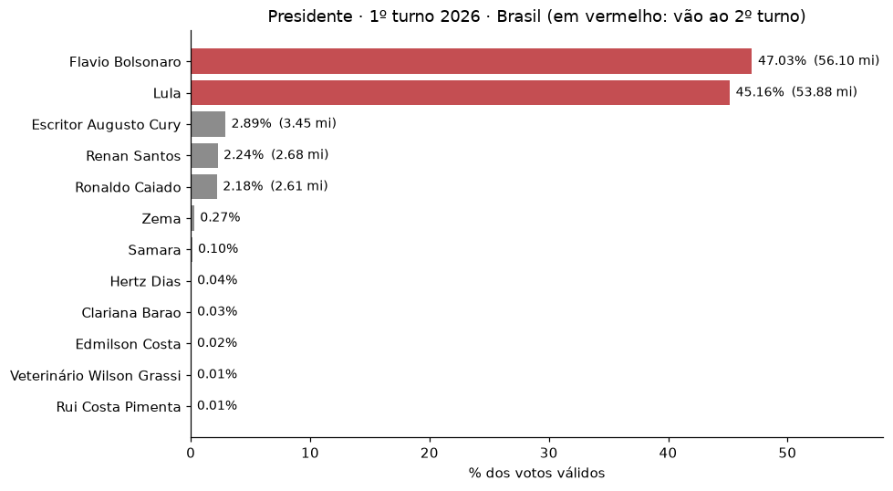
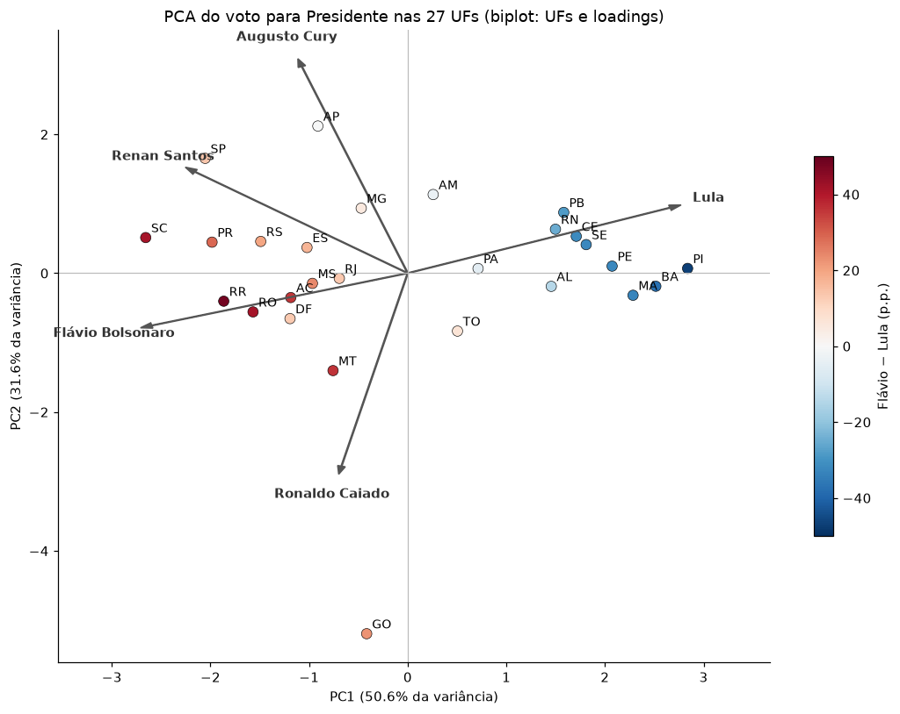
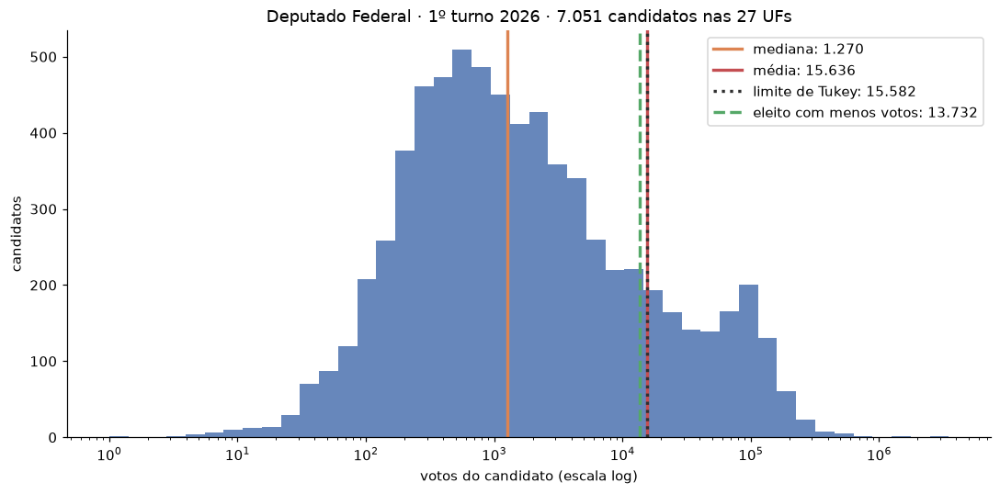
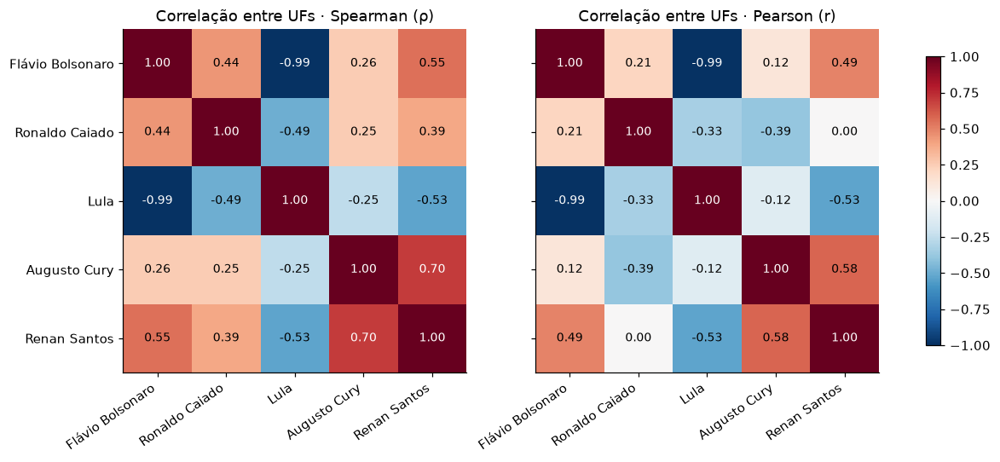
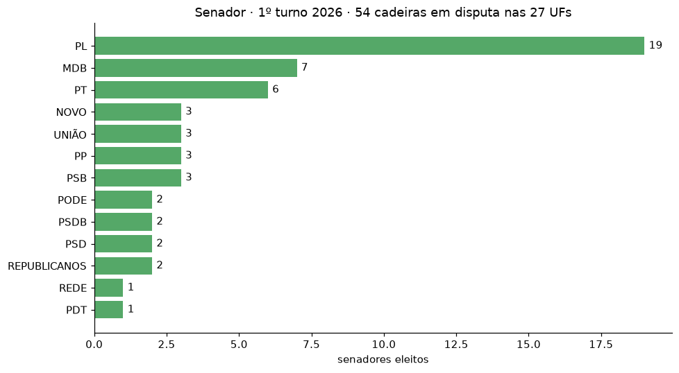
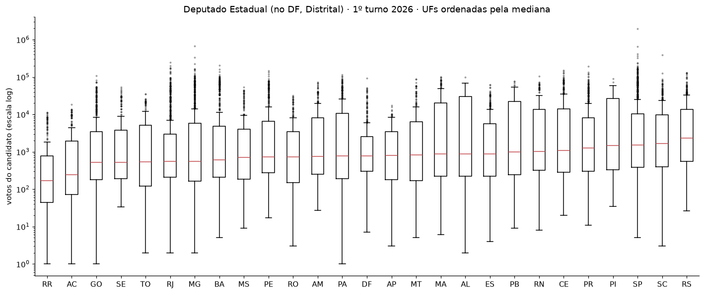

# 🗳️ Eleições 2026 · 1º turno — web scraping e análise estatística

> Coleta, limpeza e análise dos resultados oficiais do 1º turno das eleições gerais de **4 de outubro de 2026**, direto da fonte primária: o **TSE**.


Trabalho da disciplina **Métodos Estatísticos em Ciência de Dados** (FAETERJ). O notebook cobre os quatro cargos pedidos — **Presidente, Senador, Deputado Federal e Deputado Estadual** (Deputado Distrital, no DF) — nas 27 UFs.

---

## ✨ Destaques

- **Fonte primária, sem navegador automatizado.** Os portais de notícia carregam a apuração por JavaScript. Pelo DevTools, dá para ver que todos eles leem os mesmos arquivos JSON do TSE. O notebook busca esses arquivos direto em `resultados.tse.jus.br`.
- **Coleta responsável.** Cache local (cada arquivo é baixado uma única vez), pausa de 1,5 s entre chamadas, `User-Agent` identificado e um log com URL, status e horário de cada download.
- **Validação com os totais oficiais.** A soma dos votos dos candidatos bate **exatamente** com o total de votos nominais do TSE nos **110 pares cargo × UF**. No Presidente, as 27 UFs mais o exterior somam o total nacional (119.300.788 votos válidos).
- **Estatística aplicada aos dados reais.** Tendência central, dispersão, outliers (Tukey e z-score), moda, correlação de Pearson e Spearman e PCA.

## 📊 Alguns resultados

| | |
|---|---|
| **Presidente** | Flávio Bolsonaro (47,03%) e Lula (45,16%) vão ao 2º turno, separados por 2,2 milhões de votos |
| **Senador** | O PL elegeu 19 das 54 cadeiras, mais que MDB (7) e PT (6) juntos |
| **Deputado Federal** | A média (15.636 votos) é 12× a mediana (1.270). Pela regra de Tukey, 502 dos 505 eleitos são *outliers*, o que mostra que outlier não é erro |
| **Correlação** | Em Caiado × Cury, o Pearson dá −0,39 e o Spearman +0,25. Sem Goiás, o Pearson passa para +0,19: uma única UF inverte o sinal |
| **PCA** | PC1 + PC2 explicam 82,2% da variância. O PC1 é o eixo Lula × oposição (Nordeste × Sul/Centro-Oeste) e o PC2 é o eixo da terceira via |

<p align="center">
  
  
</p>
<p align="center">
  
  
</p>

<details>
<summary>Mais gráficos</summary>
<p align="center">
  
  
</p>
</details>

## 🧭 Roteiro do notebook

| Passo | O que é feito |
|---|---|
| 0 | Como a página entrega os dados e por que usar o TSE |
| 1–2 | Encontrar o JSON e reproduzir a requisição em Python (com cache e pausa) |
| 3 | Coletar os 4 cargos nas 27 UFs (111 arquivos) |
| 4 | Do JSON ao DataFrame: conversão de tipos, duplicatas e validação dos totais |
| 5 | Tendência central, dispersão, outliers, moda, correlação e PCA |
| — | Um gráfico por cargo, leitura dos loadings e os limites da análise |

## 📁 Estrutura

```
.
├── eleicoes2026_1turno.ipynb   # notebook com todo o código e a análise
├── eleicoes2026_1turno.html    # o mesmo notebook exportado (abre no navegador)
├── cache/                      # respostas JSON originais do TSE
├── dados/                      # CSVs gerados
│   ├── presidente_1t.csv
│   ├── senador_1t.csv
│   ├── deputado_federal_1t.csv
│   ├── deputado_estadual_1t.csv
│   ├── totais_por_uf_1t.csv          # eleitorado, comparecimento, brancos, nulos...
│   ├── resumo_estatistico_por_cargo.csv
│   ├── pca_loadings.csv
│   ├── pca_scores_ufs.csv
│   └── log_coleta_*.csv              # URL, status e horário de cada download
└── figuras/                    # gráficos em PNG
```

Os CSVs de candidatos têm as colunas `cargo, uf, numero, candidato, nome_completo, partido, agremiacao, votos, pct_validos, situacao, destinacao`.

## 🚀 Como rodar

```bash
git clone https://github.com/Andreknvas/eleicoes2026-analise.git
cd eleicoes2026-analise

python -m venv .venv
source .venv/bin/activate        # no Windows: .venv\Scripts\activate
pip install -r requirements.txt

jupyter notebook eleicoes2026_1turno.ipynb
```

> [!IMPORTANT]
> O notebook precisa do **matplotlib 3.9 ou mais novo**. O boxplot de Deputado Estadual usa o parâmetro `tick_labels`, que não existe nas versões anteriores, e nelas essa célula dá erro. O `requirements.txt` já pede essa versão. Se você usa um ambiente que já existia, rode `pip install -U "matplotlib>=3.9"`.

O notebook foi executado com Python 3.14, pandas 3.0, numpy 2.4, matplotlib 3.11 e scikit-learn 1.9.

Como a pasta `cache/` já vem no repositório, o notebook roda **sem acessar o servidor do TSE**. Para refazer a coleta do zero, apague `cache/`. Os 111 downloads levam cerca de 4 minutos por causa da pausa entre chamadas.

> Só quer ver o resultado? Abra o `eleicoes2026_1turno.html` no navegador.

## 🔎 Como os dados são obtidos

A configuração `comum/config/ele-c.json` lista os códigos das eleições de 2026. Assim, nenhum código fica fixo no notebook sem ter saído da própria fonte:

- **6257**: eleição federal (Presidente = cargo 1)
- **6259**: eleição estadual (Senador = 5, Dep. Federal = 6, Dep. Estadual = 7, Dep. Distrital = 8)

Cada arquivo de resultado segue o padrão:

```
https://resultados.tse.jus.br/oficial/ele2026/<eleicao>/dados/<uf>/<uf>-c<cargo:4>-e<eleicao:6>-u.json
```

O JSON tem a estrutura `carg → agr → par → cand` (cargo → coligação/federação → partido → candidato). Os números chegam como texto e os percentuais usam vírgula decimal, por isso a conversão de tipos é feita de forma explícita.

## ⚠️ Limites

- Os dados são um **retrato de 16/10/2026**. Sete UFs (AM, DF, MG, PI, RJ, RO e SC) foram retotalizadas entre 10 e 15/10 por decisões sobre candidaturas *sub judice*, então uma coleta nova pode trazer outros números.
- Os votos anulados e os anulados *sub judice* ficam nos CSVs, mas não entram nas análises.
- No Senador, cada eleitor deu dois votos: os percentuais são sobre votos, não sobre eleitores.
- A correlação e o PCA usam só 27 observações e comparam **UFs**, não eleitores (falácia ecológica). Correlação não prova causa.

## 📚 Fonte

Tribunal Superior Eleitoral — [resultados.tse.jus.br](https://resultados.tse.jus.br). Eleições 6257 (federal) e 6259 (estadual), 1º turno de 04/10/2026. Dados públicos oficiais.
